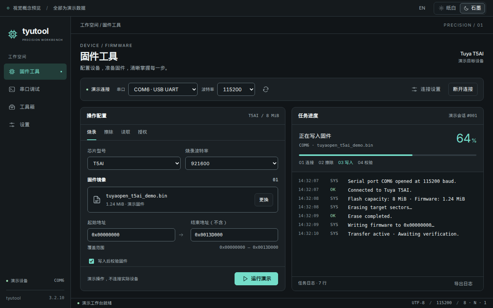
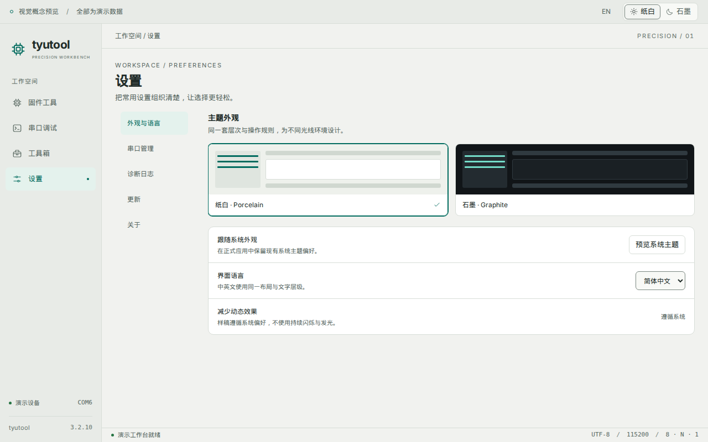

# Tyutool UI 主题更新提案：Precision Workbench

推荐方向：**精密仪器工作台**。石墨灰承载长时间调试，纸白适配明亮工作环境，薄荷青标记主要操作；通过稳定的布局、清楚的数字和克制的状态提示，建立统一的桌面工具质感。

本提案包含五个页面的可交互样稿，覆盖固件工具、串口调试、批量烧录授权、工具箱和设置。颜色、组件、页面结构和交互反馈一起更新。

## 分支与范围

- 新分支：`yj/ui-theme-overhaul`。
- 从用户指定的当前分支 `yj/ui-ux-improvements` 创建，基线为 `4ae3f0d96d85eebe65dc63a386a8781d88dbc5c4`。
- 现有命令历史、日志回看、草稿恢复等成果均在基线中。
- 设计已落实到正式应用的五个页面、共享组件与明暗主题。实施结果、回归检查和正式截图见 [实施验收记录](./implementation/README.md)；本目录的独立样稿保留作设计对照。
- 推荐同时交付浅色、深色主题，保留已有的“跟随系统”偏好。主题升级沿用现有设置值和持久化方式。

## 先看效果

[打开交互样稿](./index.html)。左侧切换页面，右上角切换中英文和明暗主题。串口页面可打开命令历史、搜索、填入命令与模拟发送；固件页可查看操作确认和完成反馈。

| 页面         | 石墨主题                             | 纸白主题                              |
| ------------ | ------------------------------------ | ------------------------------------- |
| 固件工具     | [查看](./proposal-flash-dark.png)    | [查看](./proposal-flash-light.png)    |
| 串口调试     | [查看](./proposal-serial-dark.png)   | [查看](./proposal-serial-light.png)   |
| 批量烧录授权 | [查看](./proposal-batch-dark.png)    | [查看](./proposal-batch-light.png)    |
| 工具箱       | [查看](./proposal-toolbox-dark.png)  | [查看](./proposal-toolbox-light.png)  |
| 设置         | [查看](./proposal-settings-dark.png) | [查看](./proposal-settings-light.png) |

[命令历史展开效果](./proposal-command-history-dark.png) · [最小窗口：英文固件页](./proposal-flash-1024-en.png) · [最小窗口：英文串口页](./proposal-serial-1024-en.png)





## 更新前界面为什么值得重做

以下源码行号与截图对应分支基线 `4ae3f0d`；“视觉竞争”“质感”等评价属于本提案的设计判断。

| 现状与依据                                                                                                                                                          | 对体验的影响                                                         | 本次调整                                                         |
| ------------------------------------------------------------------------------------------------------------------------------------------------------------------- | -------------------------------------------------------------------- | ---------------------------------------------------------------- |
| `src/assets/main.css:8`、`:52` 分别定义蓝色导航、橙色操作、多组阶段渐变；`:376`、`:424`、`:579`、`:920` 又为按钮、连接栏、操作卡、页头叠加渐变或阴影。              | 导航、容器和任务状态同时争夺注意力，真正的异常与关键操作不容易突出。 | 表面使用中性色；主要操作使用青色；警告、危险和成功各有独立语义。 |
| `src/components/AppShell.vue:85` 为固定 9rem 侧栏；`:98` 以居中图标作为品牌入口；`:113` 为选中项同时增加背景、边框和阴影。                                          | 页面外壳偏碎，品牌和导航的层次不够稳定。                             | 重排品牌、导航、活动端口与版本，选中项采用柔和底色与明确文字。   |
| `src/features/firmware-flash/components/FirmwareFlashAside.vue:29` 将任务日志侧栏限制为 `lg:max-w-[22rem]`。实际[固件页截图](./current-flash.png)中长日志明显换行。 | 在查看地址、阶段与错误上下文时需要来回扫视；日志获得的空间偏少。     | 配置与结果采用接近等宽的双栏，进度和日志共享稳定的结果区域。     |
| `src/features/settings/SettingsPage.vue:268` 有大面积更新入口；`:701`、`:716` 等仍使用页面专属渐变。                                                                | 更新入口的视觉分量偏大，同一应用里的设置页像另一套设计。             | 按用途组织设置；主题使用真实缩略图；更新作为清楚的普通设置区。   |
| 当前[串口页截图](./current-serial-debug.png)使用既有连接栏、独立操作区与日志区。                                                                                    | 高频调试需要更连续的“看日志—找命令—发送—继续看日志”路径。            | 大日志区、贴近发送框的历史入口和固定发送区形成连续工作流。       |

## 视觉系统

### 颜色与层次

| 角色     | 石墨 Graphite | 纸白 Porcelain | 用途                           |
| -------- | ------------- | -------------- | ------------------------------ |
| 页面底色 | `#111518`     | `#F1F2EF`      | 整体画布                       |
| 侧栏     | `#151A1D`     | `#E8EBE7`      | 导航与页面边界                 |
| 面板     | `#1A2024`     | `#FFFFFF`      | 操作区、任务区、设置组         |
| 次级表面 | `#232B30`     | `#F3F5F2`      | 悬停、局部分组                 |
| 输入背景 | `#151B1F`     | `#F8F9F6`      | 参数、地址、命令               |
| 主文字   | `#EDF2F2`     | `#202B28`      | 正文与关键数据                 |
| 次级文字 | `#A0ADB3`     | `#56665F`      | 标签、帮助、元信息             |
| 主要操作 | `#74DDC9`     | `#006B5E`      | 开始、发送、当前选择、键盘焦点 |
| 成功     | `#9BDBAF`     | `#267443`      | 已完成、校验通过               |
| 警告     | `#F0C780`     | `#895709`      | 待处理、授权结果不确定         |
| 危险     | `#FF9B98`     | `#B03436`      | 擦除、不可逆操作、失败         |
| 日志背景 | `#13191C`     | `#F8FAF7`      | 长时间阅读区域                 |

主要按钮的文字使用独立的 `on-action` 色；选中项使用浅染色背景。普通分隔线负责区分区域，输入框边界和焦点环使用更清楚的颜色。所有状态同时给出文字或图标，颜色辅助识别。

### 字体、尺寸与质感

- 沿用项目已有 Inter 与系统中文字体；日志、地址、文件名、波特率、进度数字使用等宽或等宽数字。
- 页面标题 23–25px，正文和普通控件 13px，表单标签与日志正文 12px，辅助信息 11px。正式落地以实际中文系统字体再校验，避免用缩小字号解决布局问题。
- 使用 4px 的间距基准，常用间距为 8、12、16、24px；同级组件采用一致的内边距。
- 面板圆角 10px，控件圆角 6px，常规控件高 34px，导航项至少 42px。小图标按钮保留明确的可点击区域与文字名称。
- 线性图标统一尺寸和笔画。样稿中的芯片符号是概念图形；正式实施优先沿用现有品牌资产和图标体系。
- 普通卡片依靠背景层次和细分隔线区分；弹层使用遮罩与阴影。主要按钮通过实色、位置和文案建立辨识度。
- 悬停和按下反馈约 120ms，弹层过渡控制在 160–200ms。遵循系统减少动画偏好；进度依真实任务推进。

## 外壳与通用交互

默认窗口按项目配置的 `1280×800` 设计，最小窗口为 `1024×680`，依据 `src-tauri/tauri.conf.json:17`。侧栏约 184px，较窄窗口约 160px；主要内容保持固定边距和稳定的滚动区域。

导航、页面标题、连接配置、任务面板与底部状态形成清楚的阅读顺序。底部状态仅呈现当前真实运行环境与任务信息；使用实际端口占用数据，避免静态“已连接”标签。

连接栏统一串口、波特率、刷新、高级配置和连接操作的位置。未连接、连接中、已连接、被其他工具占用、断开与错误均有文字状态；长端口名称可在下拉列表和详情中完整查看。较窄窗口按组换行，连接操作保持在一起。

表单校验紧贴字段，保留已输入内容；多项错误时给出可定位的汇总。耗时操作呈现阶段与取消入口；成功反馈不遮挡日志；错误说明提供下一步可执行动作。破坏性确认说明端口与作用范围，默认聚焦取消，支持 Tab 循环、Escape 和关闭后恢复焦点。

## 五个页面如何更新

### 固件工具：配置与结果并排

左侧按“设备参数—镜像—地址范围—选项—执行”组织配置。文件名和大小放在同一块，地址等宽对齐，结束地址明确标注是否包含。多固件段继续使用现有模型，以可扩展的段列表呈现，保留添加、删除与地址校验能力。

右侧稳定显示当前阶段、进度、文件与端口摘要、任务日志和最终结果。阶段文字对应既有 `FlashPhase`；日志区域容纳长行，必要时在区域内部横向滚动。配置区过长时单独滚动，执行按钮留在面板底部，便于最小窗口操作。

烧录、擦除、读取和授权采用同一套标签与面板规范，各自展示实际所需字段。擦除使用危险色和范围确认；认证读取结果继续使用现有安全弹层。连接参数与烧录波特率清楚区分，芯片参数继续来自 `chip-manifests.ts`。

### 串口调试：围绕日志阅读组织

日志成为页面主体。时间、方向和内容对齐，TX/RX/Sys 用文字加颜色区分；操作栏放在日志上方，发送区固定在下方。长行处理、行号与原始字节展示遵循当前能力和用户设置。

命令历史靠近发送框，展开后可以搜索、看完整内容、收藏和填入。填入恢复 ASCII/Hex 与换行参数，随后由用户发送。正式实现沿用已经完成的命令历史、草稿恢复和收藏数据；样稿只提供少量演示命令。

日志回看与命令历史使用明确不同的名称。回看状态始终提示当前时间范围、加载状态和“返回实时”；保留筛选标签、归档分页、滚动位置恢复、历史读取恢复以及归档达到上限的提示。页面切换和主题切换都保持当前阅读位置。

### 批量烧录授权：让异常能够被处理

顶部用小规模统计条展示任务进度、成功、需要处理和运行端口。批次配置显示芯片、固件与授权文件摘要，编辑入口继续承载现有配置能力。

端口任务使用稳定表格列：串口、状态、进度/说明、用时、操作。端口名、数字和进度对齐；详细信息按需展开。异常行明确说明是可重试失败还是授权结果不确定，需要物理隔离时显示处理顺序，并保留已有核验与解除隔离规则。

普通重试与批次执行使用正常操作色；涉及不确定授权结果的处理遵循后端既有边界。大列表在任务区域滚动，表头保持可见，操作反馈返回对应行。

### 工具箱：现有工具的清楚入口

当前 `src/features/toolbox/tools.ts` 只定义批量烧录授权。主卡清楚说明用途、输入和工作方式，提供直接进入工作台的入口；工具增加时扩展同一套卡片。子工具页保留面包屑和回到工具箱的路径。

### 设置：按用途找得到

按“外观与语言、串口管理、诊断日志、更新、关于”分组，内容区使用统一设置行：标题、解释、当前值和操作。主题使用可辨认的真实缩略图，明暗选择与系统偏好关系清楚。

日志查看、诊断导出、串口显示控制、自动更新间隔等现有能力继续保留。现有设置项逐个映射到新的分组，避免整理布局时遗漏开关。更新保留状态和操作入口，版本信息来自项目配置。

## 正式实施顺序

| 阶段              | 具体交付                                                   | 验收重点                                              |
| ----------------- | ---------------------------------------------------------- | ----------------------------------------------------- |
| 1. 主题基础与外壳 | 明暗语义色、字号间距、导航、标题、状态区域                 | 两套主题都成立；系统偏好和已有配置正常恢复            |
| 2. 共用组件与反馈 | 连接栏、选择器、输入、按钮、确认、通知、空白/错误/加载状态 | 键盘焦点、错误定位、端口长名称和最小窗口布局          |
| 3. 固件与串口     | 双栏任务区、大日志工作区、发送区、历史入口                 | 多镜像、四类操作、历史/草稿/分页/滚动恢复功能通过回归 |
| 4. 批量与设置     | 任务表格、隔离提示、工具箱入口、设置分组                   | 每端口状态和处理边界正确；设置项逐项对照无遗漏        |
| 5. 收尾验收       | 双语文案、四组合主题截图、键盘与视觉检查                   | 浏览器与原生 Tauri 外观一致；项目适用 CI 检查通过     |

每阶段形成独立、可审查的英文主题提交；页面更新共享同一套组件规则。

### 代码落点

现有 `--ty-*` 语义变量作为兼容入口，在 `src/assets/main.css` 中映射新的表面、文字、操作、边界和日志角色。DaisyUI 的颜色变量与这些角色保持一致，逐步消除各页重复的装饰规则；新变量仅用于确有区别的语义。

`AppShell.vue` 负责外壳，`TyConnectionBar`、`TySelect`、`TyConfirmDialog`、`TyToast` 等共用组件统一样式和状态。页面内容留在现有 feature 目录，所有新增文案同时进入中英文目录。

Pinia store、workspace 持久化、端口协调、Tauri/WS IPC 和 Rust 核心逻辑沿用既有契约。视觉重排直接使用已有事件和数据；保留日志归档、导出、凭据安全展示与每端口授权处理边界。本轮没有新增工具、替换字体依赖或定制原生标题栏的需求。

## 验收与当前验证结果

正式应用验收覆盖两种主题、两种语言、默认和最小窗口，以及未连接、占用、加载、运行、完成、失败、隔离、归档上限等状态。正常文字的目标对比度至少 4.5:1，必要的控件边界与焦点提示至少 3:1；实际叠色、悬停、选中和禁用状态分别检查。

当前独立样稿已用 Chromium 检查 **40 个视图组合**：五页 × 两语言 × 两主题 × 两窗口尺寸。各页面主区域没有横向溢出，表单控件没有横向越出窗口；日志长行允许在日志区域内滚动。检查同时确认命令搜索保留、Hex/换行参数恢复、模拟发送、确认框默认取消与键盘循环、Escape、关闭后的焦点恢复、完成反馈、哈希导航和减少动画偏好。

代表性配色核算中，主文字对比度约 14.6:1；次级文字为 7.15:1（深色）和 6.07:1（浅色）；主要按钮文字为 9.56:1 和 6.43:1。详细视图指标、交互结果和配色核算见 [验证报告](./preview-verification.json)。这些数值是选定配色的核算，正式应用仍需检查全部实际叠色和状态。

样稿使用模拟设备、日志、固件与任务数据，无硬件访问。它不实现完整固件操作表单、真实串口通信、分页归档、文件选择/导出和授权流程；非烧录标签主要演示选中态与危险色。当前验证属于设计样稿验收，原生 Tauri 和真实设备验收留在正式实现阶段。

## 本地查看与复查

在已安装项目依赖的工作区启动 Vite：

```bash
pnpm exec vite --host 127.0.0.1 --port 1430 --strictPort
```

浏览器打开：

```text
http://127.0.0.1:1430/docs/design/ui-theme-overhaul-2026-10-30/index.html
```

也可以直接打开 `index.html`；Inter 字体读取项目已有的 `node_modules`，不可用时回退系统字体。

保留 Vite 运行，在另一个终端复查样稿并重新生成截图：

```bash
node docs/design/ui-theme-overhaul-2026-10-30/verify.mjs
```

验证脚本使用项目已有 Playwright。当前界面的对照截图通过拦截 WebSocket 和填入模拟 store 数据生成；样稿截图只访问本地 HTML、CSS、JavaScript 与字体。
