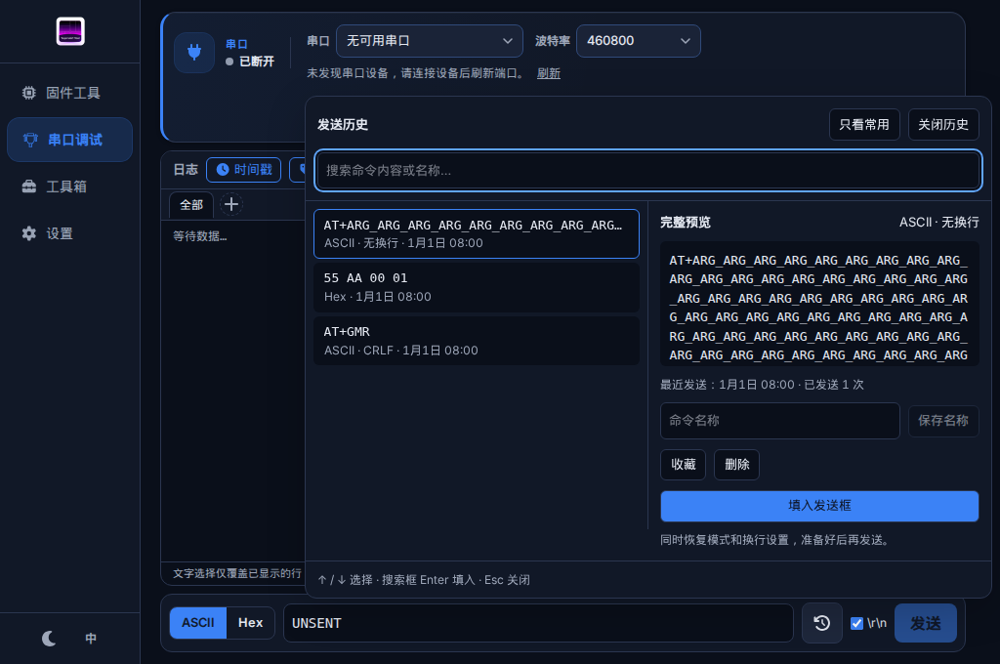
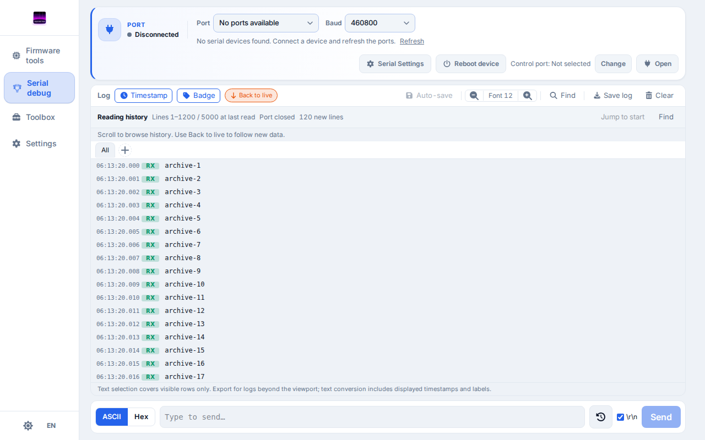

# 串口调试历史记录优化验收 — 2026-10-30

检查对象：`yj/ui-ux-improvements`。截图来自实际 Vue 页面和 Chromium，串口、归档内容与发送历史使用合成数据。

## 已实现的体验

- 发送历史支持搜索、完整预览、收藏、命名和逐条删除；记录发送模式、换行设置、最近发送时间和发送次数。保留最近 100 条非收藏命令及最多 50 条收藏，刷新后恢复。
- 同一文本的不同发送设置分别保存。旧版纯文本历史自动迁移，无法恢复的设置和时间明确标为未知；填入时保留当前设置。
- 选择命令只更新预览，点击填入才修改发送框；不会自动发送。可恢复原草稿及模式、换行设置，离线也能准备命令。输入法确认不会触发发送或保存名称。
- 当前会话日志提供历史入口、跳到开头、已加载行号范围、新增行数及返回实时。回看保持阅读位置；暂停实时滚动时也保留有界快照，接收缓冲区淘汰旧行不会替换正在看的内容。
- 搜索明确区分当前加载窗口和整个会话。筛选结果可查看附近上下文，再返回原结果与位置。读取失败保留已加载内容并提供重试；清空和切换后的旧上下文请求失效。
- 达到归档上限后持续提示数据缺口。提高上限可恢复归档，但无法补回停写期间的数据；清空会话后重置提示。

## 验证结果

| 检查 | 结果 |
| --- | --- |
| `pnpm run test:coverage` | 86 文件、1180 测试通过；语句 84.82%、分支 78.06%、函数 88.98%、行 85.70% |
| `pnpm run test:ui:confirmed` | 82 通过，0 失败、0 跳过、0 flaky |
| `pnpm run lint`、`typecheck:scripts`、`typecheck:ui`、`build` | 全部通过 |
| `pnpm run check:tauri-versions` | 6 对 npm / Rust 依赖版本一致 |
| Rust 检查 | 格式、所有 crate 的 Clippy / 测试、core 可选功能及生成绑定漂移检查通过；本次没有 Rust 改动 |

浏览器覆盖中英文、浅深主题及 `1024×680` 最小窗口，另验证了命令持久化、旧记录迁移、历史定位、读取失败重试、上下文返回和暂停期间 500 行缓冲区滚动淘汰。最终提示文案另通过 i18n 检查和生产构建，并重跑完整浏览器回归。

## 验证边界

日志归档回看覆盖当前会话，不提供跨重启的日志会话列表；发送命令历史可跨重启恢复。尚未验证原生 Tauri、真实串口、原生输入法或长时间硬件压力。浏览器与模拟 IPC 通过不代表这些场景已通过。
