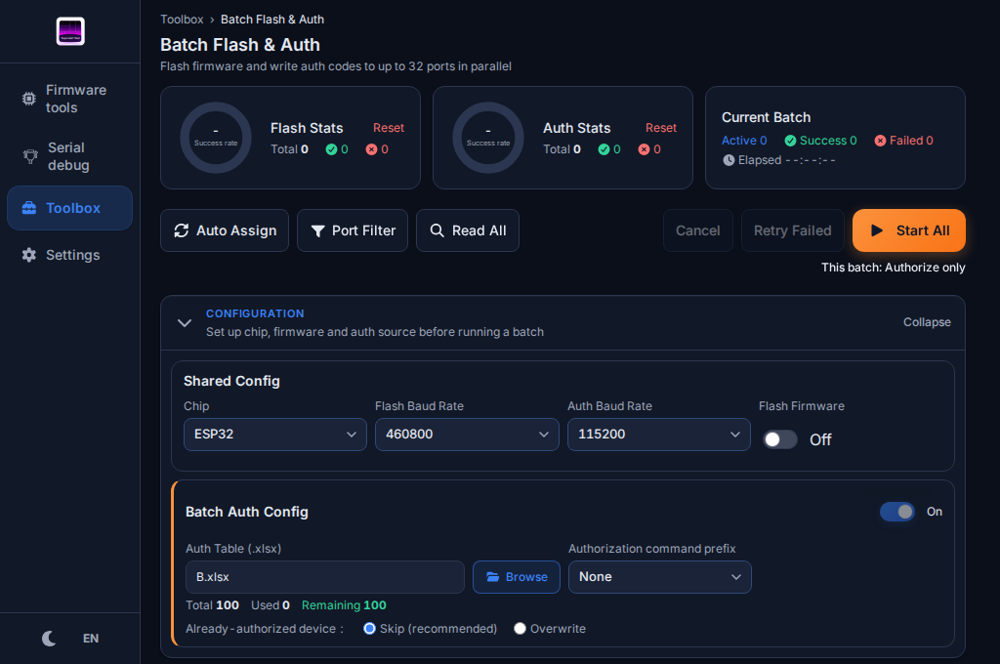
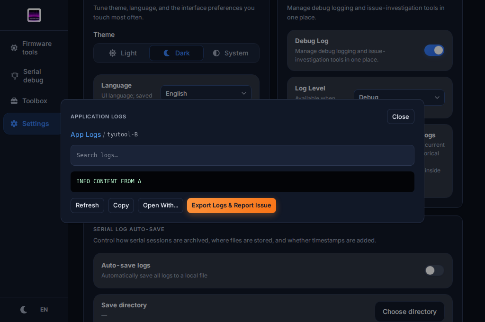
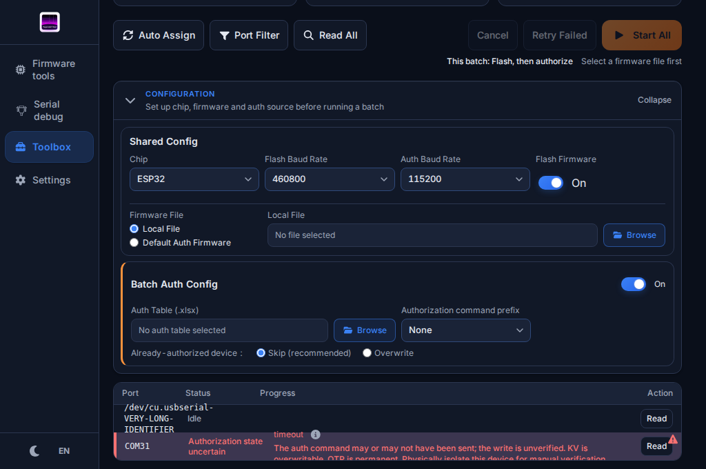
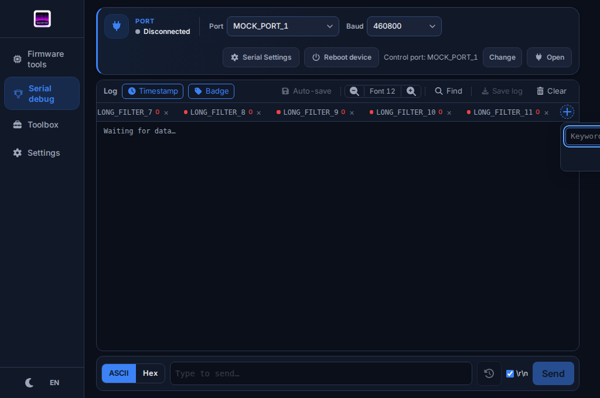
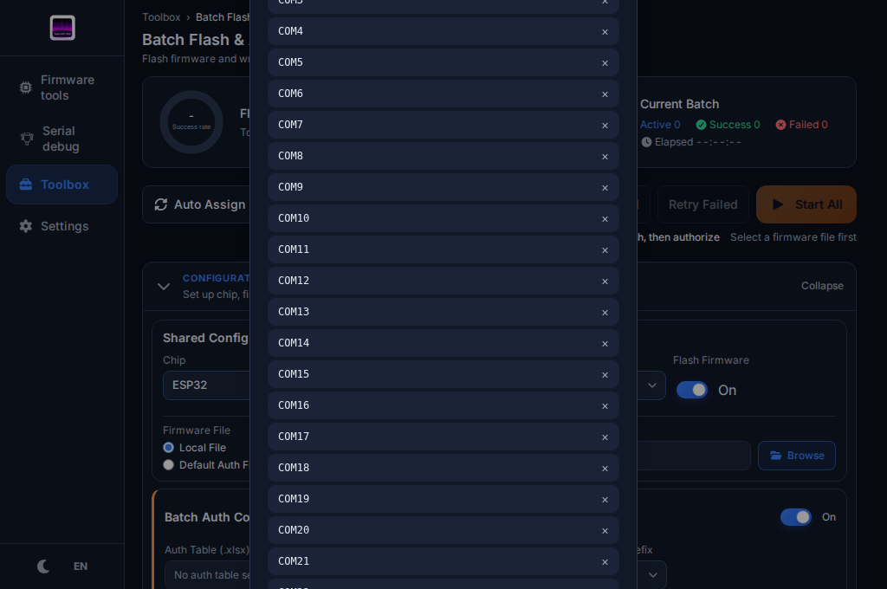
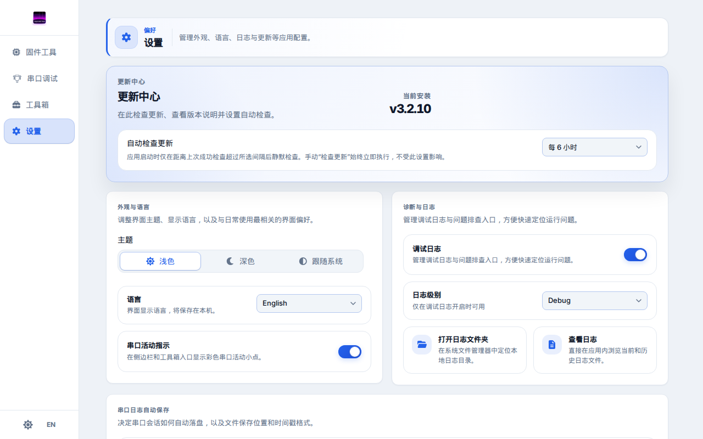
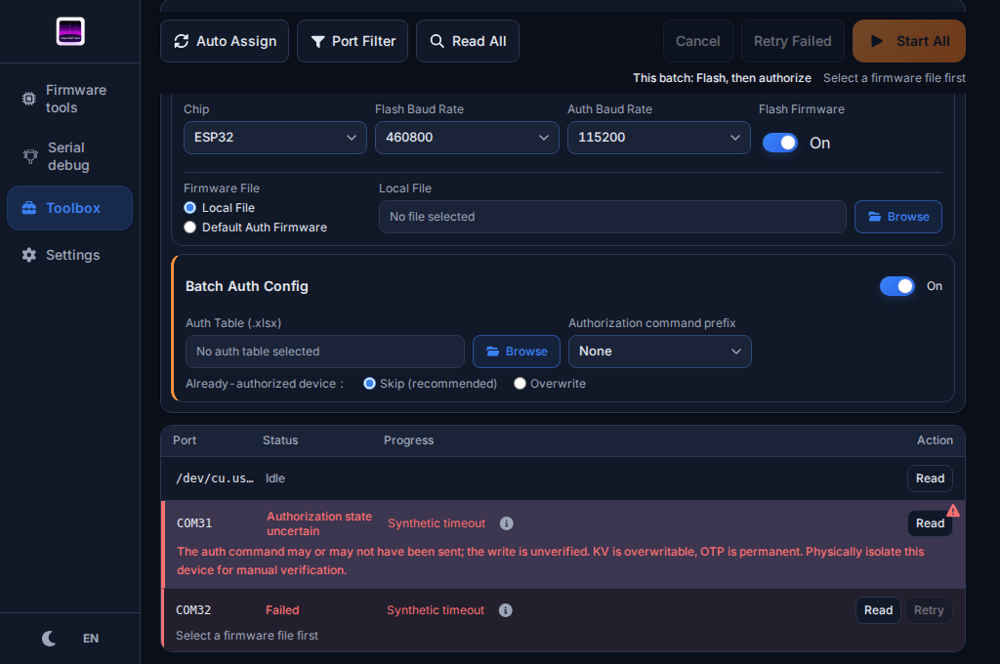
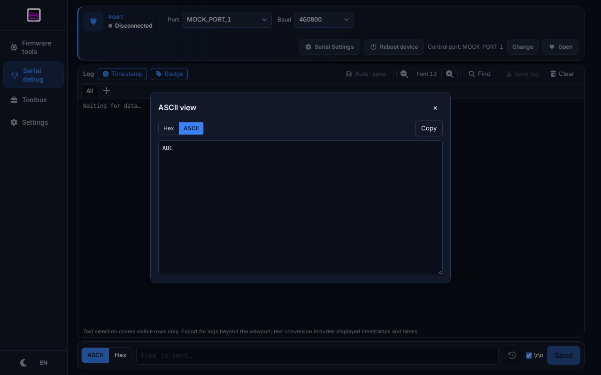

# UI/UX 细节复查 — 2026-10-30

检查对象：`yj/ui-ux-improvements`。以下问题描述、源码行号和原始截图记录修复前的检查基线，当时包含上一轮尚未提交的 UI 修复。用户随后授权先提交已有工作，再修复本次发现的问题；本次修复与验收结果见文末，原始复现保留用于对照。

共整理 **39 项**：10 项 P1、22 项 P2、7 项 P3。优先修复内容丢失、信息错配、失败无反馈和关键内容不可见，再统一键盘与弹层行为，最后调整信息密度和操作引导。

## 范围与证据

- 检查了固件工具、串口调试、工具箱、批量烧录授权、设置，以及公共组件和相关状态管理。
- 使用实际 Vue 页面和 Chromium：英文深色 `1024×680`，中文浅色 `1280×800`；补查长端口名、30 个屏蔽端口、多个筛选标签、错误状态及乱序响应。
- 端口、文件内容、Excel 统计、更新版本和失败均为合成数据。涉及桌面功能的页面检查使用模拟 Tauri IPC；没有执行实际烧录、授权、重启设备、下载或安装更新。
- **B**：浏览器已复现或直接测量；**S**：源码可确定；**D**：设计优化建议，需要确认产品取舍。条目内分别标注，不能把建议当成已经发生的故障。
- P1：可能丢内容、误导操作或挡住关键操作。P2：操作、可访问性或反馈明显不完整。P3：信息呈现和操作效率可以改善。这里没有作完整的 WCAG 合规认证。
- 完整观测值：[observations.json](./ui-ux-detail-review-2026-10-30/observations.json)。其中保留了失败探针和被纠正的早期探针；以本文说明和后续成功复现为准。临时驱动脚本位于 `/tmp/tyutool-detail-review/`，不属于项目测试套件。

## 优先级索引

| ID | 优先级 | 优化项 |
| --- | --- | --- |
| UX-01 | P1 | 发送历史上下键会清空未发送草稿 |
| UX-02 | P1 | Hex 弹窗切换格式会覆盖编辑内容 |
| UX-03 | P1 | Excel 校验期间沿用旧统计，乱序响应覆盖新结果 |
| UX-04 | P1 | 日志文件名与内容可能错配 |
| UX-05 | P1 | 重新打开更新弹窗会被旧检查结果覆盖 |
| UX-06 | P1 | 自定义波特率显示与实际使用值不一致 |
| UX-07 | P1 | 批量固定行高遮住长端口名和隔离提示 |
| UX-08 | P1 | 新增筛选失败无反馈，断线请求不结束 |
| UX-09 | P1 | 更新操作失败后只有开发者日志 |
| UX-10 | P1 | 下拉框、筛选浮层和右键菜单超出窗口 |
| UX-11 | P2 | Hex 弹窗缺少焦点、Escape 和对话框语义 |
| UX-12 | P2 | 重启目标弹窗没有管理焦点和 Escape |
| UX-13 | P2 | 筛选标签不能通过键盘直接激活 |
| UX-14 | P2 | 中文输入法 Enter 误触发新增 |
| UX-15 | P2 | 历史、筛选和右键菜单的关闭行为不一致 |
| UX-16 | P2 | 屏蔽端口较多时弹窗超高且不可滚动 |
| UX-17 | P2 | 单口重试可点击但无操作，部分可恢复状态无入口 |
| UX-18 | P2 | 日志文件列表只有鼠标入口 |
| UX-19 | P2 | 刷新日志重置阅读位置和搜索条件 |
| UX-20 | P2 | 固件日志达到 500 行后自动滚动停止 |
| UX-21 | P2 | 地址错误没有准确关联输入框 |
| UX-22 | P2 | 删除固件段后键盘焦点丢到页面根部 |
| UX-23 | P2 | 部分设置下拉框没有可访问名称 |
| UX-24 | P2 | 操作页签和主题选择缺少组内键盘行为 |
| UX-25 | P2 | 公共下拉框缺少快速定位键盘能力 |
| UX-26 | P2 | 复制成功和失败反馈不统一 |
| UX-27 | P2 | 深色主题仍有低对比文字 |
| UX-28 | P2 | 行内按钮目标偏小，名称缺少对象上下文 |
| UX-29 | P2 | 更新通知会在聚焦时消失，后续操作多一步 |
| UX-30 | P2 | 空状态和获取端口失败难以区分 |
| UX-31 | P3 | 长历史命令和文件路径缺少完整预览 |
| UX-32 | P3 | 关键操作说明主要依赖鼠标悬停 |
| UX-33 | P2 | 关闭完成横幅会藏起批次归档入口 |
| UX-34 | P3 | 固件范围与文件大小之间的关系不够直观 |
| UX-35 | P3 | 页面切换后缺少直达内容区的键盘入口 |
| UX-36 | P3 | 初次批量操作提示的名称、焦点和退出方式可改善 |
| UX-37 | P3 | 虚拟日志的跨屏选择边界需要说明 |
| UX-38 | P3 | 累计统计清零缺少轻量恢复机制 |
| UX-39 | P2 | 更新中心入口使用未注册图标 |

## P1：先处理会影响结果和判断的问题

### UX-01 发送历史会丢草稿（B）

输入 `UNSENT`，按 ↑ 得到历史 `OLD`，再按 ↓，输入变成空串；没有进入历史时，输入 `NEW` 直接按 ↓ 也会清空。依据：[SerialDebugSendBar.vue](../../src/features/serial-debug/components/SerialDebugSendBar.vue)，`onInputKey` 47–63 行；观测 `send-draft-history`、`send-arrowdown-without-history`。

建议进入历史前保存草稿，退出历史恢复草稿；未进入历史时 ↓ 不修改内容。验收：上下浏览、修改历史文本、退出历史和发送后重置索引都不会意外覆盖新草稿。

### UX-02 Hex 编辑内容被格式切换覆盖（B）

在弹窗文本框输入 `MY EDIT`，点击 ASCII 后变回原始字节对应的 `ABC`；切换每行字节数同样重新生成内容。依据：[SerialDebugRxSelectionHexPopup.vue](../../src/features/serial-debug/components/SerialDebugRxSelectionHexPopup.vue)，15–39 行；观测 `hex-popup`。

先明确这是只读查看器还是编辑器：查看器应设只读；编辑器应保留编辑数据，明确转换规则，无法转换时保留草稿并提示。验收：格式和行宽切换不静默丢弃输入。

### UX-03 Excel 校验状态与当前文件没有绑定（B）

A 表校验完成后选择 B 表，B 仍在校验时显示 A 的 100 条统计，`Start All` 仍可点击。再选择 C，先返回 C 的 3 条、后返回 B 的 99 条，最终路径是 C，统计却是 99。依据：[batch-flash-auth.ts](../../src/stores/batch-flash-auth.ts)，393–417 行；观测 `excel-stale-during-load`、`excel-response-race`。

建议统计绑定已校验路径及请求代次；新校验开始立即切到待校验状态，只有当前文件校验成功才允许启动；旧成功、旧失败和清空后的响应均失效。验收：乱序、失败后换文件、清空路径、批次结束后的重新校验均不污染当前状态。

### UX-04 日志文件名与内容错配（B）

打开 A，读取未结束时返回列表并打开 B；B 先返回、A 后返回，页面显示 `tyutool-B`，正文却是 `INFO CONTENT FROM A`。依据：[LogViewerDialog.vue](../../src/features/settings/LogViewerDialog.vue)，76–99 行；观测 `log-file-response-race`。

建议按文件及请求代次提交加载结果；切文件、关闭和重新打开均使旧请求失效，旧 `finally` 不能结束新加载状态。验收：延迟 A/B、刷新重叠和关闭后返回的成功/失败均不串内容。

### UX-05 旧更新检查覆盖重开的弹窗（B）

第一次检查未返回时关闭并重开；第二次显示合成版本 `9.9.9` 可更新，第一次较晚返回 `0.0.1`，页面又变成“已经是最新版本”。这些是模拟版本，不是实际发布信息。依据：[UpdateDialog.vue](../../src/features/settings/UpdateDialog.vue)，88–125、319–330 行；观测 `update-race-verified`。

建议每次打开创建新的检查代次，所有来源结果及安装类型结果都核对代次。验收：旧成功和旧错误都不能覆盖当前检查，也不能改变当前可用操作。

### UX-06 自定义波特率的显示不可信（B）

选择 Custom 后输入 `0`，界面显示 0，实际计算使用 460800，Open 仍可点击；恢复状态 `customBaudRate=123456`、常用值 460800 后，下拉框显示 460800，没有自定义输入框，实际仍使用 123456。依据：[SerialDebugConnectionBar.vue](../../src/features/serial-debug/components/SerialDebugConnectionBar.vue)，54–55、98–120 行；工作区确实持久化自定义值，见 [serial-debug-workspace.ts](../../src/stores/serial-debug-workspace.ts)。观测 `custom-baud`、`custom-baud-restore`。

建议区分草稿、有效值和自定义模式；无效自定义值给出字段错误并阻止打开，恢复后显示实际使用值。验收：空、0、负数、小数、自定义恢复与切回常用值一致，不能静默使用另一速率。

### UX-07 长内容撑出批量行，关键提示被遮住（B）

行高固定 40px；长串口名占 48px，授权结果不确定的隔离提示使内容高度达到 47px，后续行和列表裁切遮住文字。表头 Status 宽 96px，实际行宽 112px，Progress 列也错位。依据：[BatchFlashAuthSlotRow.vue](../../src/features/batch-flash-auth/components/BatchFlashAuthSlotRow.vue)，195–220、280–309 行；[BatchFlashAuthSlotList.vue](../../src/features/batch-flash-auth/components/BatchFlashAuthSlotList.vue)，35–38 行。观测 `batch-port-length`。

另外，行组件同时返回 Teleport 和普通根节点，父级传入的行分隔线 class 没有自动透传；浏览器输出了 Vue 的 Extraneous non-props attributes 警告。需显式把这类样式应用到实际行节点，核对连续行的分隔线。

普通行可截断并提供完整端口名；异常行应增加高度或独立展开提示，尤其不能裁掉“物理隔离、手动验证”等操作信息。表头和行使用同一列定义。验收：Windows/Linux/macOS 长名称、英文异常、中文异常、连续失败行均无覆盖，关键提示完整可读。

### UX-08 新增筛选的失败反馈和请求生命周期不完整（B+S）

后端返回合成错误后出现未处理拒绝，浮层没有错误提示，Add 仍可点击；后端在新增请求时断线，800ms 后 Promise 仍是 pending。源码中该请求只监听 message，没有 close/error 清理；这证明缺少断线结束机制，不代表 800ms 应被当作统一超时。依据：[SerialDebugChipBar.vue](../../src/features/serial-debug/components/SerialDebugChipBar.vue)，53–63 行；[serial-debug.ts](../../src/stores/serial-debug.ts)，1357–1394 行；[ws-transport.ts](../../src/transport/ws-transport.ts)，559–609 行。观测 `filter-failure-verified`、`filter-close-pending`。

建议新增显示处理中，防重复提交，错误就地显示且保留输入；WS 关闭、错误、发送失败均结束请求并清理监听。验收：GUI IPC 拒绝、浏览器服务错误、断线和连续点击均能恢复重试，不挂起、不重复新增。

### UX-09 更新失败没有用户可见结果（B+S）

合成的 `update_check` 拒绝后，页面恢复“新版本可用”和 Update 按钮，没有失败原因；`startDownload`、安装失败路径只记录诊断日志/console。依据：[UpdateDialog.vue](../../src/features/settings/UpdateDialog.vue)，334–391、395–421 行；观测 `update-download-failure`。安装失败本轮仅源码检查。

建议下载/校验/安装失败保留可见状态，提供可理解原因、重试或手动下载入口；“没有可更新包”也应更新页面状态。验收：模拟网络、校验、安装失败后用户知道结果和下一步，按钮与实际状态一致。

### UX-10 浮层缺少窗口边缘适配（B+S）

- 设置的归档大小下拉框位于 y=641.7，高 164.2，最后一项位于 y=770，窗口高度只有 680。
- 批量右键菜单在 x=987、y=666，宽 158、高 32，超出 `1024×680` 窗口。
- 12 个筛选标签后，新增浮层从 x=955.9 开始，宽 256，右边到 1211.9。

依据：[TySelect.vue](../../src/components/TySelect.vue)，127–136 行；[BatchFlashAuthSlotRow.vue](../../src/features/batch-flash-auth/components/BatchFlashAuthSlotRow.vue)，23–25、174–178 行；[SerialDebugChipBar.vue](../../src/features/serial-debug/components/SerialDebugChipBar.vue)，19–29 行。串口右键菜单同样使用原始坐标，源码可确定；本轮事件合成被浏览器调整了坐标，因此不把其截图当作越界复现。

建议按剩余空间翻转、限制高度并夹紧坐标；滚动、缩放和窗口变化后重新定位。验收：四个角、触发器贴底、长选项、横向滚动的标签栏都能看到并操作完整浮层。

## P2：补齐交互和反馈

### UX-11 Hex 弹窗没有完整的模态行为（B）

打开后焦点仍在背景；Escape 不关闭；没有 dialog 角色/名称，关闭按钮和文本框也没有完整名称，格式按钮未暴露选中状态。依据：[SerialDebugRxSelectionHexPopup.vue](../../src/features/serial-debug/components/SerialDebugRxSelectionHexPopup.vue)，58–127 行；观测 `hex-popup`。

建议接入现有 `useModalFocus`，明确标题、字段和切换状态。验收：打开进入弹窗、Tab 留在弹窗、Escape 关闭、关闭回到触发器，读屏能识别内容和当前格式。

### UX-12 重启目标弹窗没有焦点管理（B）

点 Change 后焦点不在弹窗内，Escape 不关闭。依据：[SerialDebugConnectionBar.vue](../../src/features/serial-debug/components/SerialDebugConnectionBar.vue)，424–490 行；观测 `reboot-dialog`。

建议复用模态行为，并检查短窗口内的最大高度和滚动。验收：Change 及“配置并重启”两个入口都保持焦点、退出和校验一致；该验收不需要真的重启设备。

### UX-13 筛选标签不能通过键盘激活（B）

标签是可点击 div，`tabIndex=-1` 且无角色，只有里面的删除按钮可 Tab 到；“全部”也没有暴露当前选择。依据：[SerialDebugChipBar.vue](../../src/features/serial-debug/components/SerialDebugChipBar.vue)，92–123 行；观测 `filter-keyboard`。

建议提供真正的激活按钮，删除操作独立；选择 tab 或 pressed-button 模型后实现完整状态。验收：不用鼠标可切换全部/任意筛选、移除筛选，删除后焦点回到邻近有效项。

### UX-14 中文输入法 Enter 会误新增（B）

`isComposing=true` 的 Enter 新增了筛选标签；屏蔽端口输入也新增了 `COM_NEW`。依据：[SerialDebugChipBar.vue](../../src/features/serial-debug/components/SerialDebugChipBar.vue)，66–70 行；[BatchFlashAuthPortFilterModal.vue](../../src/features/batch-flash-auth/components/BatchFlashAuthPortFilterModal.vue)，78 行。观测 `filter-ime-enter`、`port-filter-ime`。

建议与已修复的发送框一致，组合输入期间不提交。验收：组合输入 Enter 只确认候选词，结束组合后的 Enter 才提交；正常英文提交不变。

### UX-15 非模态菜单的关闭和焦点行为不一致（B+S）

发送历史 Escape 不关闭；新增筛选只有输入框上的 Escape 生效，焦点在正则按钮时无效；批量和串口右键菜单 Escape 都不关闭。依据：[SerialDebugSendBar.vue](../../src/features/serial-debug/components/SerialDebugSendBar.vue)，119–141 行；[SerialDebugChipBar.vue](../../src/features/serial-debug/components/SerialDebugChipBar.vue)，32–50、66–70 行；两个日志/批量菜单组件。观测 `send-history-escape`、`filter-popover-escape`、`batch-menu-corrected`、`serial-menu-measured`。

建议统一 Escape、外部点击、Tab 离开与焦点返回；触发器暴露展开状态，菜单项可键盘进入。验收：任意子控件获得焦点时都能退出，不留透明遮罩，不跳回页面根部。

### UX-16 屏蔽端口列表过长时弹窗超高（B）

30 个屏蔽端口使弹窗高 1266px，顶部 y=-293，680px 窗口里无法看到全部头部和列表；弹窗没有高度上限及内部滚动。依据：[BatchFlashAuthPortFilterModal.vue](../../src/features/batch-flash-auth/components/BatchFlashAuthPortFilterModal.vue)，40–115 行；观测 `port-filter-long`。

建议限制弹窗高度，列表内部滚动，标题和新增区保持可见；长端口名不挤走移除按钮。验收：0/1/30/100 个端口、短窗口和英文长名称均可新增、移除和关闭。

### UX-17 单口重试缺少前置条件反馈（B+S）

无固件的失败行仍显示可用 Retry，点击后状态完全不变；store 先检查配置并直接 return。`no_code` 在 store 可单口重试，行组件只为 failed 提供入口。依据：[BatchFlashAuthSlotRow.vue](../../src/features/batch-flash-auth/components/BatchFlashAuthSlotRow.vue)，386–396 行；[batch-flash-auth.ts](../../src/stores/batch-flash-auth.ts)，645–654 行。观测 `batch-retry`；`no_code` 为源码核验。

建议行重试与全局重试共用禁用原因，显示可恢复状态的入口；有隔离要求的设备继续禁止直接重试。验收：缺固件、Excel 待校验/无效、端口被占用和 no_code 都有明确结果，不出现可点击的静默操作。

### UX-18 日志文件列表只能用鼠标打开（B）

文件行是点击 tr，没有可聚焦链接/按钮，tabIndex=-1。依据：[LogViewerDialog.vue](../../src/features/settings/LogViewerDialog.vue)，369–374 行；观测 `log-file-keyboard`。

建议文件名使用按钮或链接，保留表格语义。验收：键盘能打开任意文件，从正文返回列表后回到原文件。

### UX-19 刷新日志打断阅读和搜索（B+S）

滚到顶部后刷新，滚动变为接近底部的 2648px；`openFile` 同时清空搜索和匹配索引，刷新直接复用这个动作。搜索框没有显式 label，↑/↓ 仅使用箭头字符命名。依据：[LogViewerDialog.vue](../../src/features/settings/LogViewerDialog.vue)，76–109、440–478、529–538 行。观测 `log-refresh-reset`、`log-search-names-colors`。

建议区分首次打开与刷新，保留搜索和阅读锚点，只有用户正在跟随末尾时自动跟随；箭头提供“上一个/下一个匹配”名称。验收：刷新追加内容不跳走，筛选条件仍在，无匹配与匹配定位状态明确。

### UX-20 达到日志上限后不再跟随新增内容（B）

固件日志达到 500 行后追加一条长日志，总数仍是 500，内容高度从 11070 变为 12805，scrollTop 保持 10657；未勾 Lock scroll。长度 watcher 无法感知同长度替换。依据：[useFlashLog.ts](../../src/features/firmware-flash/useFlashLog.ts)，16–20、48–51 行；观测 `flash-log-cap-scroll`。

建议追加动作显式触发跟随，或监听最后一条的变化。验收：第 499/500/501 条、长行替换和清空后都能正确跟随，同时保留锁定滚动功能。

### UX-21 地址错误关联到了错误的字段（B+S）

起始地址填 `BAD!` 后，start 没有 `aria-invalid`/`aria-describedby`，end 却标为 invalid；宽表格布局的两个输入都没有 invalid，错误文字没有可关联 ID。依据：[FlashSegmentTable.vue](../../src/features/firmware-flash/components/FlashSegmentTable.vue)，88–114、195–230 行；观测 `flash-range`。

建议错误模型指出具体字段或范围，关联错误说明；重复字段名称带固件段编号。验收：非法 start、非法 end、end 小于 start、多段错误和两种布局均能定位正确输入。

### UX-22 删除固件段后焦点落到 body（B）

聚焦删除按钮并删除第二段，`document.activeElement` 变成 BODY。依据：[FlashSegmentTable.vue](../../src/features/firmware-flash/components/FlashSegmentTable.vue) 的删除入口；观测 `flash-delete-focus`。

建议删除后聚焦邻近段的同类操作或 Add segment，避免用户重新遍历页面。验收：删除中间、最后一段和连续删除时焦点始终可见且有效。

### UX-23 设置下拉框缺少名称与说明关联（B）

日志等级、可见日志行数、归档大小三项没有关联 label/aria-label；部分有 id，但标题是普通 span。依据：[SettingsPage.vue](../../src/features/settings/SettingsPage.vue)，394–409、521–559 行；观测 `settings-select-names`。

建议标题关联公共下拉框，补充 hint 的 describedby；日志搜索、自定义波特率和新增筛选字段一并检查。验收：每个控件都读出用途、当前值和需要的说明，不依赖布局位置。

### UX-24 页签和主题组缺少组内导航（B）

Flash 页签按 → 仍留在 Flash，全部四项都是 Tab 停靠点且无 panel 关联；主题 role=radio 按 → 仍为 Dark，三个选项都是独立停靠点。依据：[FirmwareFlashOperations.vue](../../src/features/firmware-flash/components/FirmwareFlashOperations.vue)，109–140 行；[SettingsPage.vue](../../src/features/settings/SettingsPage.vue)，288–325 行。观测 `flash-tab-keyboard`、`theme-radio-keyboard`。

建议使用完整的页签/单选组键盘模型，或采用语义相符的原生控件。验收：方向键、首尾定位、Tab 进入离开和选中/面板关系一致，禁用项跳过。

### UX-25 下拉框快速定位能力不足（B+S）

九个波特率选项中 Home/End 不改变活动项；源码没有字符定位，关闭时也不处理 ArrowUp。基本的上下、Enter 和 Escape 已有，不应重复报告成“完全不能用键盘”。依据：[TySelect.vue](../../src/components/TySelect.vue)，180–217 行；观测 `select-keys`。

建议按所选 combobox 模型补首尾键和字符定位；长端口列表可进一步提供搜索，但不必为短列表强加搜索框。验收：定位动作只移动活动项，确认才修改值，并跳过禁用选项。

### UX-26 复制反馈不统一，失败容易被误解（B+S）

日志 Copy 拒绝后页面无反馈；Hex、凭据输入等 catch 也静默忽略。批量错误弹窗附加复制操作没有完成反馈，串口右键复制未处理拒绝。相比之下固件日志已有成功/失败日志。依据：[LogViewerDialog.vue](../../src/features/settings/LogViewerDialog.vue)，205–215 行；[TySecretInput.vue](../../src/components/TySecretInput.vue)，37–49 行；Hex、串口 LogView、批量 SlotRow 的复制入口。观测 `log-copy-failed`。

建议统一短暂成功状态和就地失败提示；失败保留内容并允许手动复制，不输出凭据到普通日志。验收：成功、拒绝、API 不可用和连续点击都给出真实结果，反馈可被读屏感知。

### UX-27 深色主题有遗漏的对比问题（B+S）

Hex 活动格式按钮白字配 `#3b82f6`，对比约 3.68:1；浅色 `#2563eb` 约 5.17:1。更新按钮同样白字，深色渐变包含 `#3b82f6`。日志 DEBUG 实测约 4.22:1，TRACE 约 2.70:1。UUID 是 10px 且 opacity 0.5，辨认困难。依据：Hex 样式149 行、[UpdateDialog.vue](../../src/features/settings/UpdateDialog.vue) 1240–1251 行、LogViewer 的 `LEVEL_CLASS`、SlotRow 329 行；观测 `color-hex-*`、`update-dark-primary`、`log-contrast-ratios`、`batch-uuid-measured`。

建议使用主题内容色 token，日志等级颜色要兼顾可读性；UUID 保持足够字号和亮度，靠层级而非极低透明度降权。验收：两主题、hover/selected 状态实测，正文采用项目明确的对比目标；本轮不把测量等同完整合规结论。

### UX-28 行内按钮太小，名称难以区分对象（B+S）

Excel 错误详情是 16×16px，普通错误详情 20×20px；多个“查看完整错误”“移除”“复制”名称没有说明对应端口/字段。依据：SlotRow 291、343 行及 PortFilter/ChipBar/TySecretInput；观测 `batch-small-targets`、`batch-uuid-measured`。

建议通过内边距扩大点击区域，同时保持列表密度；名称补端口、标签或凭据字段上下文。不要把桌面行高机械增加到移动端尺寸。验收：连续多行错误时按钮容易命中，焦点圈不被截断，读屏能区分操作对象。

### UX-29 更新通知在聚焦时自动消失（B+S）

通知按钮获得焦点后仍按 6 秒计时移除，8.5 秒检查时通知已消失、焦点落到 BODY；Open Settings 只导航设置，需要用户再次打开更新中心。依据：[TyToast.vue](../../src/components/TyToast.vue)，14–45 行；观测 `toast-real-time`。早期 6.2 秒和虚拟时钟探针没有确认消失，已由真实计时复现替代。

建议 hover/聚焦期间暂停消失；明确点击动作是否直接打开更新中心，或保持当前标签准确。验收：用户正在读/聚焦通知时不消失，退出后按预期计时，点击直接到达预期任务。

### UX-30 空状态缺少原因区分和就地下一步（B+S+D）

无端口时串口页显示 No ports available、Disconnected、Waiting for data，缺少就地连接提示；`refreshPorts` catch 直接转空数组。记住的端口又会追加为可选项，当前可用与历史选择难以区分。批量空列表提示也不能区分未分配、全被屏蔽或端口被占用。依据：ConnectionBar 34–51、123–135 行、[BatchFlashAuthSlotList.vue](../../src/features/batch-flash-auth/components/BatchFlashAuthSlotList.vue) 空状态。观测 `offline-empty` 只验证了空列表，未验证所有服务失败/热插拔场景。

建议保留端口枚举错误状态，区分“没有设备”“获取失败”“历史端口不可用”，对应显示刷新/连接/检查过滤条件等动作。验收：无设备、服务不可用、拔出已选设备、全被屏蔽和被其他功能占用分别验证；需补真实设备检查。

## P3 与其他源码可确定的优化

### UX-31 长命令和路径缺少完整预览（S+D）

发送历史使用单行 ellipsis，无 title/展开；多个固件只读路径也截断，长文件名很难区分版本和目录。依据：SendBar 232–241 行，FlashSegmentTable 的 firmwarePath 输入，BatchFlashAuthConfig 的本地路径区。

建议选中/聚焦历史项可查看完整内容，路径提供完整预览及复制；不扩展成新的文件管理功能。验收：同前缀不同尾部命令、Windows/Unix 长路径都能可靠辨认。

### UX-32 关键说明过度依赖悬停（S+D）

TySelect 的端口配对提示仅在 mouseenter 显示；自动释放、ANSI 等说明主要放 title，键盘操作缺少等价说明入口。依据：TySelect 的 `onOptionLiMouseEnter`，SerialDebugSettingsModal 的 title，SerialDebugConnectionBar 的 optionTooltip。

建议活动选项或焦点触发相同说明，必要时将能改变操作判断的提示变成短说明并关联控件。验收：不用鼠标也能知道双串口用途、自动释放和 ANSI 选项含义。

### UX-33 关闭完成横幅后归档入口消失（S）

`canArchive` 在批次完成后仍可为 true，但归档按钮只渲染在 `completionBanner` 内；dismiss 仅清空 banner，页面没有另一处入口。依据：[BatchFlashAuthDashboard.vue](../../src/features/batch-flash-auth/components/BatchFlashAuthDashboard.vue)，完成横幅；batch store 216–224、1134–1136 行。尚未做完整批次的浏览器/设备复现。

建议归档入口放到持续可见的批次操作区，横幅关闭只隐藏通知。验收：关闭通知后仍可归档/重试归档，保存位置和错误可查看，开始新批次后的状态明确。

### UX-34 固件范围和文件大小的关系不够直观（S+D）

选文件时计算 end=start+size，之后编辑 start 不会重算 end，且列表不显示文件大小或范围字节数。用户难以判断 end 是文件推导值还是人工配置。依据：[flash.ts](../../src/stores/flash.ts)，263–269、281–345 行；FlashSegmentTable 的字段布局。

先明确用户是否可以独立编辑范围；建议显示文件大小、范围长度和 end 的含义，保留人工覆盖的明确状态。不要把后端烧录规则复制到前端。验收：选文件、改起点、人工改终点和多段添加都能解释最终范围；核心行为以 Rust 为准。

### UX-35 键盘直达内容区的入口不足（S+D）

main 有 tabindex=-1，但没有 skip link 或页面切换后的内容焦点策略。反复切换工具时需要经过侧栏和快捷按钮。依据：[AppShell.vue](../../src/components/AppShell.vue) 的 nav/main/RouterView。

建议提供“跳到主要内容”入口，并明确路由切换后的焦点策略；后台任务、恢复页面和 KeepAlive 不应强抢输入焦点。验收：键盘能快速到达标题/首个任务控件，返回历史页面时位置可预测。

### UX-36 初次批量提示可改善名称与退出方式（S+D）

原生 dialog 有五段提示和内部滚动，但未将标题关联为对话框名称；初始焦点落到后面的可操作控件时可能跳过顶部内容；cancel.prevent 阻止 Escape，虽有可见取消按钮，但行为与其他弹窗不同。依据：[DisclaimerModal.vue](../../src/features/batch-flash-auth/components/DisclaimerModal.vue)，17–39 行及提示/按钮布局。

保留必要风险确认，建议关联标题、将初始阅读位置放顶部，并让退出明确等价于取消进入工具。验收：英文/中文、短窗口、键盘首次进入都能读到重点，不绕过确认，不导致操作陷阱。

### UX-37 虚拟日志跨屏选择能力需要解释（S+D）

源码明确说明原生选择只覆盖已挂载行，拖过视口不能选择未渲染日志；选中文本转 Hex 也使用 TextEncoder，转换的是显示文本，而不是从归档恢复原始字节。依据：[SerialDebugLogView.vue](../../src/features/serial-debug/components/SerialDebugLogView.vue)，525–550 行。

建议说明跨屏选择边界，引导使用现有导出/范围操作；“文本转 Hex”与“查看原始字节”名称要明确。是否增加跨行字节选择需要单独评估，不把文本转换直接判定为字节损坏。验收：复制、导出和转换的对象范围清晰，用户不会把包含时间戳/标签的显示文本当作原始串口数据。

### UX-38 累计统计清零缺少轻量恢复（S+D）

累计烧录/授权统计的 Reset 直接调用清零并保存，没有撤销；同名按钮也没有在名称中区分两个统计组。依据：BatchFlashAuthDashboard 的 Reset，batch store 1161–1170 行。

建议优先采用短暂撤销或轻量确认，并补清零对象名称；不为普通开关增加确认流程。验收：误点可恢复，当前批次统计和累计统计区别明确，处理中是否允许清零由产品决定。

### UX-39 更新入口的箭头图标未注册（B+S）

桌面更新入口使用 `fas/angle-right`，图标注册只包含 `faChevronRight`，浏览器输出 `Could not find one or more icon(s)`，入口箭头缺失。依据：[SettingsPage.vue](../../src/features/settings/SettingsPage.vue)，245 行；[icons.ts](../../src/icons.ts)，注册列表；最后核对 Vite 浏览器输出时确认。

建议复用现有已注册的右箭头图标，并核对其他静态图标引用。验收：桌面更新入口图标正常显示、没有缺图标错误；装饰图标不增加多余读屏内容。

## 建议实施顺序与验收边界

1. **内容与状态正确性**：UX-01～09；先写能复现草稿、乱序响应、失败和显示错配的测试，再实施。涉及授权隔离信息的显示先处理。
2. **弹层及键盘共同行为**：UX-10～18、21～25、28、39；复用已有模态能力，为非模态菜单补一致的退出与定位逻辑，修复缺失图标。
3. **阅读与反馈**：UX-19～20、26～30、33；检查日志跟随、复制、通知和空状态，不仅检查初始截图。
4. **产品呈现取舍**：UX-31～32、34～38；确认只读/编辑、范围含义、历史和统计恢复后再改，避免扩展无关功能。

检查基线阶段没有重新运行全套 Rust/前端 CI，当时只新增报告和证据。上一轮通过的检查记录见 [ui-ux-regressions.md](./ui-ux-regressions.md)；本次代码修复后的检查结果如下。

仍需真实 Tauri 和设备验证：系统文件/目录选择器与剪贴板权限、系统缩放与字体、串口热插拔和所有权转移、真实 Excel 校验、长时间串口接收、固件烧录进度/失败、更新下载与安装失败。页面截图和模拟 IPC 不能替代这些验收。

浅色中文设置页用于视觉基线，未发现默认 `1280×800` 布局横向溢出；不应据此判定所有长内容和弹层都已覆盖。

## 本次修复与验收 — 2026-10-30

已有工作先按公共组件、串口、批量、固件和检查文档分为五个提交（`eb64bab`、`0e8b634`、`04e9279`、`a7294c5`、`fd2f975`）。本节对应随后实施的细节修复，不将原始缺陷截图当成当前界面。

39 项均已作对应处理。产品取舍采用只读 Hex 查看器、独立可编辑的起止地址、清零前轻量确认，以及明确说明虚拟日志选择范围。跨屏原始字节选择和 LOG-03 固定前缀仍属于独立设计议题，不包含在本次实现中。

下表的 **UT** 表示 Vitest 状态/组件测试，**UI** 表示真实 Chromium 页面测试，**源码/说明** 表示实现和文档核验。涉及 Tauri 的 UT 使用模拟 IPC，不能代表原生桌面或设备验收。相关测试可从 [新增浏览器回归](../../tests/ui/ui-detail-regressions.spec.ts)、[完整 UI 结果](./ui-ux-detail-review-2026-10-30/repair-ui-results.json) 和源文件旁的 `.test.ts` 查到。

| ID | 本次处理 | 验证 |
| --- | --- | --- |
| UX-01 | 进入历史前保存草稿，退出恢复；旧发送完成不重置新的历史浏览状态 | SendBar UT：上下浏览、未进入历史、新草稿及延迟发送 |
| UX-02 | Hex 弹窗改为只读查看器，切换格式不产生可被覆盖的编辑草稿 | Hex UT、UI：readonly 与格式切换 |
| UX-03 | 换表清空旧统计，显示校验中并禁用写入；路径与代次保护成功、失败和清理 | batch store UT：乱序成功/失败、清空、启动条件；cleanup 代次源码核验 |
| UX-04 | 日志读取、文件列表与编辑器查询分别保护请求代次 | LogViewer UT：A/B 乱序成功和失败不串内容 |
| UX-05 | 每次打开更新弹窗生成新的检查代次，旧结果与安装类型结果不覆盖当前状态 | UpdateDialog UT：重开后旧成功；旧失败和安装类型代次源码核验 |
| UX-06 | 恢复实际自定义速率，验证 1–4294967295 整数；无效草稿禁止 Open | ConnectionBar UT：恢复、空/零/负数/小数；上界与常用值切换源码核验 |
| UX-07 | 批量行使用最小高度，隔离提示独占完整一行；统一列宽并显式透传行样式 | UI：长端口、隔离提示无裁切、相邻行无覆盖、列位置 |
| UX-08 | 新增筛选显示 pending/失败并保留草稿；WS 关闭/错误/发送异常均结束并清理监听 | ChipBar、WS UT；删除失败提示补回归 |
| UX-09 | 下载、安装失败就地显示，busy 在 finally 清理，失败包可重试安装 | UpdateDialog UT：更新检查操作拒绝、安装拒绝与重试；下载 catch 源码核验 |
| UX-10 | 公共浮层根据视口翻转与限高，计入边框；菜单 Teleport 并限制四角坐标 | FloatingPanel UT；UI：底部下拉、缩窗、筛选、批量四角和串口菜单 |
| UX-11 | Hex 关联标题、管理模态焦点、Tab 循环与 Escape 返回 | Hex UT、UI |
| UX-12 | 重启目标弹窗复用模态焦点与 Escape，限制高度 | ConnectionBar UT；实际重启未执行 |
| UX-13 | 标签激活和删除拆为独立按钮，激活状态使用 aria-pressed | ChipBar UT |
| UX-14 | 筛选与屏蔽端口输入忽略 composition Enter | 两组件 UT；原生输入法仍待验收 |
| UX-15 | 历史、筛选及菜单补 Escape、焦点离开关闭和恢复触发点 | SendBar/SlotRow UT，筛选和菜单 UI |
| UX-16 | 屏蔽端口列表内部滚动，长名称换行，删除操作带对象名称 | UI：中英、浅深、100 端口；PortFilter UT |
| UX-17 | 单口重试使用配置及端口占用原因，补 no_code 入口，隔离仍禁止重试 | SlotRow、batch store UT；真实设备恢复未执行 |
| UX-18 | 文件名使用按钮，正文返回列表恢复原文件焦点 | LogViewer UT：文件按钮路径；返回焦点源码核验 |
| UX-19 | 刷新保留查询/位置，只在原本位于底部时跟随；失败保留已加载正文 | LogViewer UT：刷新位置、搜索、失败保留；搜索与匹配按钮名称源码核验 |
| UX-20 | appendLog 显式触发跟随，长度被裁到 500 后仍有效；尊重锁定 | FlashLog UT：上限追加、内容高度变化、锁定 |
| UX-21 | 两种布局分别标注正确的无效字段，关联错误 ID，名称包含段号 | SegmentTable UT、UI |
| UX-22 | 删除后聚焦邻近同类操作或添加按钮 | SegmentTable UT、UI |
| UX-23 | 设置下拉框、搜索与自定义输入关联名称及说明 | Settings UI、ConnectionBar UT、源码 |
| UX-24 | 操作页签/主题组采用单一 Tab 停靠点，方向键和首尾定位，关联 panel | UI：主题组、四操作页签 |
| UX-25 | 下拉补 Home/End、字符定位、关闭时 ArrowUp，并跳过禁用项 | TySelect UT、UI |
| UX-26 | 公共复制反馈用于凭据、Hex、日志及串口菜单；确认框复制显示真实成功/失败 | CopyFeedback、Confirm UT；串口剪贴板拒绝 UI；不把凭据写入诊断日志 |
| UX-27 | 已发现的主按钮/Hex 使用主题前景色；提升 DEBUG/TRACE 与 UUID 可读性 | Hex/Flash 浅深及 hover 对比 UI；其他指定颜色源码核验，不作完整合规结论 |
| UX-28 | 扩大错误详情与删除目标，名称补端口、筛选词或字段上下文 | SlotRow/ChipBar UT；批量目标尺寸源码核验 |
| UX-29 | 通知 hover/聚焦暂停计时；点击直接打开更新任务并消费路由参数 | Toast UT；UI：聚焦超过 6 秒、更新弹窗直达 |
| UX-30 | 串口及批量区分扫描中、失败、无设备、全被过滤和未扫描，提供刷新 | ConnectionBar、batch store UT；WS 扫描使用现有端口接口 |
| UX-31 | 长历史在键盘聚焦时换行，路径和端口显示完整 title | 长历史 UI；路径说明源码核验 |
| UX-32 | 自动释放/ANSI 说明常显并关联控件；下拉选项说明支持键盘活动项 | TySelect UT，SerialSettings 源码 |
| UX-33 | 归档入口和结果移到持续可见的批次区，关闭横幅只隐藏通知 | Dashboard UT：dismiss 后入口保留 |
| UX-34 | 显示测量文件大小、范围长度、结束地址排除语义；不联动覆盖人工地址 | SegmentTable UT；范围交互 UI，文件大小测量状态源码 |
| UX-35 | 增加跳到内容区链接，直接聚焦 main | 源码核验；后台导航不新增抢焦点逻辑 |
| UX-36 | 首次提示关联标题，焦点和阅读位置从顶部开始，Escape 等价取消进入 | 原生 HTML dialog UI；不是原生 Tauri 验收 |
| UX-37 | 常显已挂载行选择边界，名称及双语文档明确显示文本转换 | 串口选择 UI、源码与使用说明；保留固定行高虚拟模型 |
| UX-38 | 清零前轻量确认，名称区分累计烧录/授权组；取消不修改统计 | Dashboard UT |
| UX-39 | 更新入口复用已注册 chevron-right，补注册批量屏蔽 ban 图标 | 图标引用与注册源码核验，浏览器未再出现缺图标错误 |

验收完成：`pnpm run test:ui:confirmed` **72 passed、0 failed、0 skipped、0 flaky**，其中新增 23 个细节用例；`pnpm run test:coverage` **85 文件、1164 测试通过**，覆盖率 statements 84.82%、branches 78.01%、functions 89.54%、lines 85.74%。Lint、前端/UI/脚本类型检查、6 对 Tauri 版本检查与生产构建均通过。Rust 格式、全部 crate 的 Clippy/测试、core 可选功能检查及生成绑定漂移检查均通过。汇总与命令保存在 [repair-verification.json](./ui-ux-detail-review-2026-10-30/repair-verification.json)。

先建立了草稿、Excel/日志/更新乱序、WS 生命周期、日志跟随、输入与弹层的失败回归，再实施修复。最终浏览器回归额外发现范围说明挤住 Browse 和定位漏算边框；修正后保留原可见性与几何断言。测试探针改为真实 MouseEvent、实际日志行和键盘焦点路径，没有放宽边界要求。

此次验收使用合成串口/文件/更新数据。尚未执行真实 Tauri、硬件烧录/授权/复位、长时间串口压力、实际更新下载/安装/重启、系统剪贴板权限、原生输入法或读屏验证。源码/模拟 IPC 通过与这些验收分别记录。
